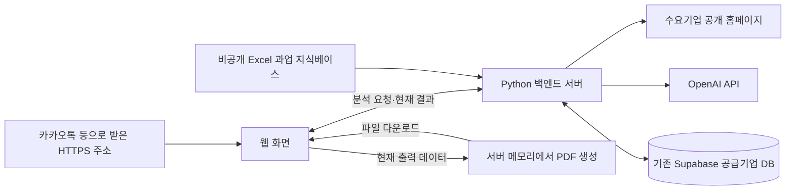

# OSS AX 매칭 서비스 배포 방식 조사

조사일: 2026-10-15 · 대상: 초기 시범 사용자 10~50명

## 확정된 서비스 범위

사용자는 카카오톡 등으로 받은 HTTPS 주소로 접속해 기업 홈페이지를 분석하고, 현재 결과를 PDF 보고서로 내려받는다. 로그인·개인 계정·검색 기록 저장·사용자별 기록 분리는 필요하지 않다. 이전 제안의 개인 콘솔·인증·계정별 결과 DB 구성은 철회했다.

현재 결과는 열린 페이지의 메모리에만 유지한다. 새로고침하면 초기화되며, PDF 다운로드는 사용자가 명시적으로 파일을 보관하는 수단이다. 카카오톡으로 링크를 전달하기 위한 카카오 API 연동은 필요하지 않다.

## 초기 배포 추천

**Render의 유료 Python 웹 서비스 한 개와 기존 Supabase 공급기업 DB를 우선 활용한다.** 같은 서버에서 정적 화면과 분석 API, PDF API를 제공해 초기 운영 구성을 단순하게 유지한다. 로그인이나 개인 기록 저장을 위한 별도 서비스는 추가하지 않는다.

현재 `http.server`는 개발용이다. 공개 배포 시에는 FastAPI·Uvicorn 같은 운영용 실행 구성으로 전환하고, 현재 분석 함수와 PDF 생성 함수를 재사용한다. 화면 다운로드 기능 구현과 공개 서버 배포는 별도 작업이며, 현재 클라우드 배포는 하지 않았다. [Python HTTP 서버 문서](https://docs.python.org/3/library/http.server.html), [FastAPI 배포 문서](https://fastapi.tiangolo.com/deployment/)

## 후보 비교

| 배포 방식 | 이 프로젝트에 대한 판단 | 확인 자료 |
| --- | --- | --- |
| Render 유료 웹 서비스 + 기존 Supabase | 초기 운영 추천. Python과 정적 화면·PDF API를 한 서비스로 운영 가능. 싱가포르 제공 | [웹 서비스](https://render.com/docs/web-services), [리전](https://render.com/docs/regions) |
| Railway Python 서비스 + 기존 Supabase | 사용량 기반 과금을 선호하면 대안. Hobby 최소 월 $5, Pro 최소 월 $20에 사용 크레딧 포함; 초과 사용 추가 과금 | [요금](https://railway.com/pricing), [리전](https://docs.railway.com/deployments/regions) |
| Google Cloud Run + 기존 Supabase | 서울 리전이 중요하거나 Google Cloud 운영 경험이 있으면 대안. 컨테이너·IAM 등 설정 필요 | [리전](https://docs.cloud.google.com/run/docs/locations), [요금](https://cloud.google.com/run/pricing) |
| Vercel 화면 + 별도 Python 처리 | 가능하지만 현재 프로젝트를 위해 호스팅을 분리할 필요가 크지 않음. 함수 실행시간 제한도 검토 필요 | [Functions 제한](https://vercel.com/docs/functions/limitations) |

위 우선순위는 현재 코드와 수정된 요구사항에 대한 판단이다. 플랫폼 성능을 실제로 비교 측정한 결과는 아니다.

## 비용 계획

웹 서버 한 개를 한 달 유지하고, Supabase Pro의 기본 Micro 프로젝트 하나를 사용하는 조건이다. 기존 Supabase 요금제는 조회하지 않았다. 이미 지불 중인 DB 비용은 중복 가산하지 않아야 한다.

| 항목 | 작은 구성 | 메모리 여유를 둔 구성 |
| --- | ---: | ---: |
| Render Python 웹 서비스 | Starter 512MB: $7 | Standard 2GB: $25 |
| Supabase Pro 기본 프로젝트 | $25 | $25 |
| Render 운영자 1명: Hobby 워크스페이스 | $0 | $0 |
| 기본 합계 | **$32/월** | **$50/월** |
| 여러 운영자가 Render Pro 워크스페이스를 사용할 경우 | **$57/월** | **$75/월** |

인스턴스 가격과 워크스페이스 요금은 별도다. 서비스 이용자 수와 Render 관리자 계정 수는 다르다. [Render 자사 인스턴스 가격](https://render.com/articles/render-vs-railway), [워크스페이스 요금](https://render.com/docs/new-workspace-plans), [Supabase 요금](https://supabase.com/pricing)

추천 예산은 운영자 한 명 기준 월 $50에 별도 사용료를 더하는 구성이다. 2GB는 Excel 적재와 분석·PDF 동시 실행의 메모리 실측 전 계획값이다. 실제 측정 후 작은 구성으로 줄이거나 용량을 늘린다. AI API 비용·도메인·세금·초과 트래픽은 별도다. 로그인용 메일 발송 비용은 필요하지 않다.

## 배포 전 필요한 작업

1. 운영용 Python 서버 구성과 HTTPS 주소를 준비한다. 서버는 플랫폼의 PORT와 `0.0.0.0`에 바인딩한다.
2. 배포 이미지에 `web/`, Python 소스, ReportLab, 내장 한글 글꼴 및 라이선스를 포함한다. 자바스크립트 홈페이지 수집을 위해 Playwright와 Chromium 및 OS 의존성도 설치한다(`python -m playwright install --with-deps chromium`). [Playwright 브라우저 설치](https://playwright.dev/python/docs/browsers)
3. Excel 지식베이스를 배포 서버에서 읽을 수 있는 비공개 경로로 제공한다. 개인 PC의 OneDrive 경로에 의존하지 않는다.
4. OpenAI·Supabase 비밀키는 서버 환경변수에 둔다. 현재 공급기업 DB의 비공개 접근을 유지한다.
5. 실제 분석 시간·메모리·동시 실행량·API 비용을 측정한다. 동적 페이지에서 실행되는 브라우저 프로세스의 메모리도 포함한다. 등록 사용자 50명과 동시 분석 50건을 같은 조건으로 가정하지 않는다.
6. 카카오톡 iOS·Android 인앱 브라우저와 외부 브라우저에서 접속·결과 표시·PDF 다운로드를 확인한다.

홈페이지 수집과 여러 AI 호출은 현재 하나의 HTTP 요청에서 실행된다. 로그인·기록 저장이 불필요하더라도 처리시간과 모바일 연결 지속 문제는 별도로 측정해야 한다. 실제 사용에서 긴 연결 문제가 확인되면 분석 처리만 별도 워커로 분리하는 방식을 후속 검토한다. 이는 개인 계정·영구 검색 기록 기능을 도입한다는 뜻이 아니다. [Render 워커](https://render.com/docs/background-workers), [Cloud Run 비동기 작업](https://docs.cloud.google.com/run/docs/triggering/using-tasks)

## 현재 구현된 PDF 경로

웹 화면의 ‘추천 결과’와 대칭되는 오른쪽에 ‘보고서 다운로드’ 버튼이 있다. 현재 결과의 전체 업무·공급기업·연락처·상세정보를 `POST /api/report.pdf`로 보내면 Python이 PDF를 메모리에서 생성하고 파일로 반환한다. 이 과정에는 추가 AI 호출·크롤링·DB 조회·서버 파일 저장이 없다. 기존 검색 기록 저장 기능과 버튼은 제거되었으며, 이전 브라우저 기록 DB는 정리한다.

이 문서는 수정된 요구사항을 반영한 배포 제안이다. 클라우드 서비스 생성·유료 결제·DB 변경·실제 배포는 수행하지 않았다.
