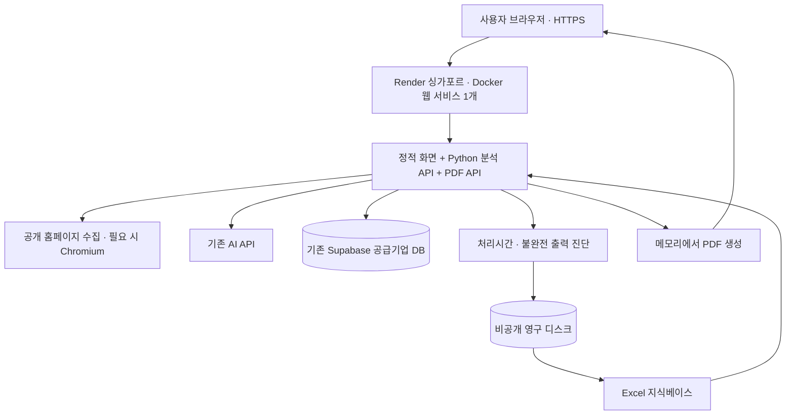

# OSS AX 매칭 서비스 배포 조사 · 2026-10-17

조사 기준: 한국시간 2026-10-17, 저장소 `2bfdcbe` 및 로컬 운영 통계. 기존 2026-10-15 조사에 현재 코드·실측 시간·최신 플랫폼 조건을 반영한 후속 문서다. 클라우드 계정의 실제 요금제·리전은 조회하지 않았다.

후속 실조회: 2026-10-17 02:09~02:12 KST에 **현재 Supabase가 Free·서울·ACTIVE_HEALTHY이며 DB 약 37MB**임을 확인했다. 따라서 아래 비용표의 Supabase Pro 월 $25는 선택 가정이고 현재 DB 비용이 아니다. [실제 Supabase 배포 적합성 점검](supabase-deployment-readiness-2026-10-17.md)에 보안·조회·무료 운영 조건을 정리했다.

## 추천안

**초기 시범 운영에는 Render 싱가포르의 유료 Docker 웹 서비스 1개 + 기존 Supabase + 소형 영구 디스크를 추천한다.** Python 운영 서버에서 화면·분석 API·PDF API를 함께 제공한다. 시작 사양은 **1 CPU / RAM 2GB**, 분석 동시 실행은 **1건**으로 제한한 뒤 실측해 조정한다.

최저 청구액보다 초기 구현량, 운영 부담, 월 고정비 예측 가능성, 기존 진단 기록 보존을 우선한 판단이다. 2GB가 충분하다는 부하 시험 결과는 아직 없으며, Linux에서 Chromium의 실행·격리 조건을 검증해야 배포안을 확정할 수 있다.

**서울 리전이 필수이거나, 사용하지 않는 시간의 서버 비용을 줄이는 것이 최우선이면 Google Cloud Run 서울을 우선한다.** 이 경우 파일 진단 기록과 Excel 전달을 외부 저장소 방식으로 바꾸는 작업, IAM·이미지 저장소·로깅 설정이 추가된다. [Cloud Run 리전](https://docs.cloud.google.com/run/docs/locations), [요금 구조](https://cloud.google.com/run/pricing)

기존 문서에 있는 ‘시범 사용자 10~50명, 로그인·개인 검색 기록 없음’을 계획 가정으로 사용했다. 이는 이번에 새로 확인한 이용자 수가 아니다. 동시 사용자 요구량, 국내 저장 의무, 운영 조직의 기존 클라우드 계약이 다르면 아래 전환 기준을 적용한다.

## 1. 프로젝트에서 확인한 배포 조건

| 확인 사항 | 코드·자료 근거 | 배포에 주는 영향 |
| --- | --- | --- |
| Python 3.11+, HTML/CSS/JavaScript 화면 | `pyproject.toml`, `web/` | 화면과 API를 하나의 Python 서비스로 운영 가능 |
| 현재 서버는 `ThreadingHTTPServer` | `src/oss/web_server.py` | 공개 운영 전 FastAPI·Uvicorn 등으로 HTTP 실행부 교체 필요 |
| 분석 요청 안에서 크롤링 → 여러 AI 호출·검증 → 공급기업 조회 실행 | `web_server.py`, `business_profile.py`, `ax_opportunity.py`, `supplier_advice.py` | 긴 연결과 동시 실행을 수용해야 함 |
| 동적 사이트는 Playwright·Chromium 사용 | `src/oss/browser_render.py` | 브라우저 바이너리·Linux 시스템 패키지·메모리 필요 |
| Excel을 시작 시 읽어 메모리에 유지 | `src/oss/workbook.py`, `web_server.py` | 배포 서버에 비공개 Excel 파일이 있어야 시작 가능 |
| 개인 OneDrive 자동 탐색 경로 사용 가능 | `default_workbook_path()` | 운영 환경에서는 `OSS_WORKBOOK_PATH`를 명시해야 함 |
| `data/`와 `.env`는 Git 제외 | `.gitignore`, `git ls-files` | GitHub 연결만으로 데이터·비밀키가 배포되지 않음 |
| 공급기업 프로필은 서버에서 Supabase REST API 조회 | `src/oss/supplier_profile.py` | 기존 DB 재사용 가능, secret key는 서버에만 보관 |
| PDF는 ReportLab·내장 한글 글꼴로 메모리 생성 | `src/oss/pdf_report.py`, `src/oss/fonts/` | PDF용 별도 서버나 파일 저장소가 필요하지 않음 |
| 처리시간·불완전 출력 진단을 로컬 파일에 기록 | `search_timing.py`, `empty_output.py` | 컨테이너 재시작·배포 후에도 남길 저장 경로 필요 |
| 두 기록기는 프로세스 내부 `threading.Lock` 사용 | 동일 파일 | 초기에는 서버 프로세스 1개로 운영; 여러 프로세스가 같은 로그를 갱신하는 구성은 피함 |
| 공개 분석 API의 호출량 제한·전역 분석 동시 실행 제한 없음 | `web_server.py` | 로그인 없이 공개할 때 비용·메모리 보호 장치 추가 필요 |

Python 공식 문서는 `http.server`를 운영용으로 권장하지 않는다. 포트만 외부에 개방하는 방식으로는 공개 배포 준비가 끝나지 않는다. [Python 공식 문서](https://docs.python.org/3/library/http.server.html)

### 실제 분석 처리시간

`reports/search-timing/searches.jsonl` 260건을 읽어 집계했다. 기간은 **2026-10-15 20:05 ~ 2026-10-17 01:16 KST**, 코드 식별자 15종이 섞여 있다. P95는 정렬한 값의 `ceil(0.95 × 표본 수)`번째 값이다.

| 집계 대상 | 건수 | 평균 | 중앙값 | P95 | 최장 |
| --- | ---: | ---: | ---: | ---: | ---: |
| 전체 | 260 | 87.10초 | 100.71초 | 162.91초 | 259.02초 |
| HTTP 200 응답 | 209 | **106.22초** | 109.83초 | **169.31초** | **259.02초** |
| 그 외 응답 | 51 | 8.73초 | 0.32초 | 100.71초 | 138.65초 |

짧게 실패한 요청이 전체 평균을 낮춘다. 플랫폼 선택에는 HTTP 200 요청의 약 106초 평균과 약 259초 최장값을 우선 참고했다. 마지막 기록의 코드 식별자 `21d5bd29f0cd43c8`만 보면 14건, 평균 113.99초, 최장 216.76초다.

이 값은 로컬 개발·진단 요청의 관측치이며, 클라우드 성능이나 동시 부하 시험 결과가 아니다. HTTP 200에도 일부 단계 오류나 빈 추천이 포함될 수 있으므로 209/260을 서비스 품질 지표로 해석하지 않는다. 브라우저 전송·화면 렌더링 시간, Linux의 최고 메모리, 요청별 AI 토큰 비용은 이 로그로 알 수 없다.

## 2. 배포 방식 비교

| 후보 | 이 프로젝트와의 적합성 | 비용·운영 특성 | 판단 |
| --- | --- | --- | --- |
| **Render 유료 Docker 서비스** | Python·Chromium·글꼴을 같은 이미지에 포함. 현재 긴 HTTP 처리와 파일 기록 구조를 수용하기 쉬움 | 2GB 서버 월 $25. 디스크 별도. 싱가포르 제공, 서울 없음 | **현재 시범 운영 1순위** |
| **Google Cloud Run 서울** | 컨테이너·긴 요청 지원, 서울 배치 가능. 컨테이너 외부로 기록을 내보내는 변경 필요 | 요청 처리 중 할당 자원 기준 과금. 유휴 인스턴스를 0으로 줄이면 비용 절감 가능, 초기 설정·콜드 스타트 고려 | **국내 리전·간헐 사용 우선 시 1순위** |
| **Railway Docker 서비스** | 현재 구조와 볼륨을 수용 가능, 싱가포르 제공 | 사용한 RAM·CPU·네트워크·볼륨 과금. 비용은 실제 사용량에 따라 변동 | **유력한 대안** |
| **Vercel Functions 중심** | Python도 지원하나 Chromium 패키징·실행과 파일 기록 방식을 별도 검증·변경해야 함 | 실행시간·메모리·함수 번들 제한과 베타 기능 적용 조건 확인 필요 | **가능하지만 이번 구조의 우선 선택은 아님** |
| **직접 관리하는 Linux VM/VPS + Docker** | OS·브라우저·디스크 설정을 직접 제어 가능 | 패치·TLS·프로세스 관리·백업·모니터링을 직접 담당 | **기존 서버·운영 인력이 있을 때 검토** |

Render의 Docker·HTTPS 지원은 [Docker 배포 문서](https://render.com/docs/docker)와 [웹 서비스 문서](https://render.com/docs/web-services), 리전은 [Render 리전 목록](https://render.com/docs/regions)에서 확인했다. Railway의 사용량 과금은 [공식 요금 문서](https://docs.railway.com/pricing/plans), 싱가포르 지원은 [공식 리전 목록](https://docs.railway.com/deployments/regions)에 근거한다. VM/VPS 행은 특정 제품 견적이 아니라 직접 운영 방식에 대한 판단이다.

### 요청 제한은 최신 값으로 비교해야 한다

- **Render:** 자사 문서는 웹 서비스의 HTTP 응답 제한을 최대 100분으로 안내한다. 다만 재배포나 프로세스 종료까지 진행 중 작업을 보장하는 것은 아니다. [Render 공식 안내](https://render.com/docs/render-vs-vercel-comparison)
- **Cloud Run:** 기본 요청 제한 5분, 최대 60분. 앱 서버와 앞단 프록시의 제한도 함께 맞춰야 한다. [Cloud Run 요청 제한](https://docs.cloud.google.com/run/docs/configuring/request-timeout)
- **Vercel:** Fluid compute의 Node.js·Bun·Python 기준 Hobby 최대 300초, Pro·Enterprise 일반 최대 800초. 지원 런타임에서 1,800초 확장 최대값은 베타다. Python 함수 번들은 기본 최대 500MB이며, 더 큰 번들을 지원하는 기능도 별도 베타다. [Vercel 공식 제한](https://vercel.com/docs/functions/limitations)

현재 표본은 전부 300초 미만이었다. 따라서 ‘분석이 106초이므로 Vercel에서 실행할 수 없다’는 결론은 맞지 않는다. 이번에 Render를 우선하는 이유는 **브라우저와 OS 의존성을 일반 컨테이너로 묶고 기존 파일 기록을 유지하는 편이 간단하기 때문**이다. Railway의 요청 제한 수치는 이번에 확인한 공식 문서에서 확정하지 못했으므로 제시하지 않는다.

## 3. 추천 구성의 구체적인 형태

| 항목 | 초기 제안 | 상태·이유 |
| --- | --- | --- |
| 서비스 지역 | Singapore | Render의 한국 인접 제공 지역. 실제 크롤링 대상·기존 DB와 통신 시험 필요 |
| 실행 환경 | 버전을 고정한 Linux Docker 이미지 | Chromium과 OS 의존성 재현, 다른 컨테이너 플랫폼으로 이전 용이 |
| 컴퓨트 | `1c-2g`, 구 명칭 Standard | 1 CPU / RAM 2GB의 계획값. 브라우저 포함 최고 메모리 실측 전 가정 |
| 운영 서버 | FastAPI + Uvicorn, 프로세스 1개 | 기존 분석·PDF 함수 재사용, 로그 파일의 프로세스 간 경쟁 방지 |
| 분석 동시 실행 | 전체 1건부터 시작 | 초과 요청은 대기 상태 안내 또는 429/503으로 응답. 측정 전 무제한 실행 금지 |
| 장시간 처리 | 전체 예산 600초를 시작 목표로 검증 | 현재 최장 약 259초에 여유를 둔 제안. 현재 구현에 전체 제한은 없음 |
| 디스크 | 1GB부터, 예: `/var/data` | Excel과 진단 파일 보존. 파일 증가량을 측정해 용량·보존기간 조정 |
| 화면 URL | 우선 기본 HTTPS 주소, 필요 시 사용자 도메인 | 별도 화면 호스팅·카카오 API 없이 주소 공유 가능 |
| 배포 운영 | 검증한 커밋을 사용량 적은 시간에 수동 배포 | 디스크가 있는 서비스의 중단·진행 요청 유실을 관리 |

동시 분석 1건은 사용자 50명을 한 번에 처리할 수 있다는 뜻이 아니다. 성공 응답 평균 106초를 단순 적용하면 시간당 약 34건이며, 실패·재시도·여유 시간은 포함하지 않은 산술상 참고치다. 실제 사용에서 여러 사람이 동시에 분석을 요청하면 용량이나 작업 처리 구조를 다시 결정해야 한다.

동기 분석 함수는 FastAPI의 동기 엔드포인트 등으로 실행해 이벤트 루프를 막지 않게 한다. 분석 중에도 화면·PDF·상태 확인이 응답해야 한다. 단순히 클라이언트의 연결만 600초에 끊는 것으로는 백엔드 작업이 멈추지 않으므로, 외부 호출·브라우저 정리까지 포함한 종료 처리를 검증해야 한다.

### 영구 디스크를 선택할 때 받아들이는 제한

Render의 기본 파일시스템은 일시적이므로 현재 `reports/`를 그대로 쓰면 재배포·재시작 때 진단 기록이 사라진다. 영구 디스크는 마운트 경로 아래 파일만 보존한다. 기록 경로를 `/var/data/reports/...`로 지정할 수 있도록 운영 진입부를 바꾸고, Excel은 `/var/data/private/knowledge-base.xlsx`처럼 웹 공개 디렉터리 밖에 둔다. [Render 영구 디스크](https://render.com/docs/disks)

**디스크를 붙인 서비스는 다중 인스턴스 확장과 무중단 배포를 사용할 수 없다.** 디스크 서비스는 종료 대기시간도 사용자 지정할 수 없다. 따라서 분석이 진행 중이면 신규 요청을 잠시 막고 기존 요청을 마친 뒤 배포하는 절차가 필요하다. 플랫폼 유지보수나 장애로 진행 중 요청이 끊길 가능성은 남는다. [디스크 제약](https://render.com/docs/disks), [Render 배포·종료 처리](https://render.com/docs/deploys)

시범 운영에서는 기존 파일 기록을 보존하는 이 구성을 택한다. 무중단 운영이 필수이면 처음부터 Excel을 버전 관리된 비공개 객체 저장소에서 읽고, 진단을 외부 로그·객체 저장소에 보내는 구성이 적합하다. 이때 파일 기반 누적 통계도 중앙 집계로 바꿔야 한다.

## 4. 월 비용

USD, 한 달 계속 실행하는 웹 서비스 1개와 1GB 디스크의 기본 계획값이다. AI API·도메인 등록·세금·초과 트래픽·추가 백업 비용은 별도다. 계정에 이미 청구 중인 Supabase 비용을 신규 배포 비용에 중복 가산하지 않는다.

| 항목 | 운영자 1명 · 시범 구성 | 팀 운영 구성 |
| --- | ---: | ---: |
| Render `1c-2g` 웹 서비스 | $25.00 | $25.00 |
| Render 워크스페이스 | Hobby $0 | Pro $25.00 |
| 영구 디스크 1GB | $0.25 | $0.25 |
| **신규 호스팅 기본비** | **$25.25/월** | **$50.25/월** |
| Supabase Pro 기본 Micro 프로젝트 1개를 별도 지불한다고 가정 | +$25.00 | +$25.00 |
| **위 DB까지 포함한 기본비** | **$50.25/월** | **$75.25/월** |

2GB 웹 서비스는 월 $25이고 디스크는 GB당 월 $0.25다. 컴퓨트의 현재 ID는 `1c-2g`이며 구 명칭 `standard`와 사양·가격이 같다. [Render 가격](https://render.com/pricing), [2GB 서비스 가격 확인](https://render.com/docs/render-vs-heroku-comparison), [컴퓨트 명칭](https://render.com/docs/compute-plans)

Render Pro는 현재 좌석당 요금이 아닌 **워크스페이스당 월 $25 정액**이다. Hobby는 운영자 1명, 월 외부 전송 5GB, Pro는 월 25GB를 포함하며 초과분은 GB당 $0.15다. 서비스 이용자 수와 관리 좌석 수는 별개다. [현행 워크스페이스 요금](https://render.com/docs/new-workspace-plans)

Supabase Pro는 월 $25부터이며 유료 플랜의 월 $10 컴퓨트 크레딧으로 Micro 프로젝트 하나를 충당하는 조건이다. 실제 조직에 추가 프로젝트·상위 사양·초과 사용이 있으면 달라진다. Free는 1주 비활성 시 일시중지될 수 있어 공유 서비스 운영에서는 확인이 필요하다. [Supabase 공식 가격](https://supabase.com/pricing)

### 대안의 비용을 해석하는 방법

Railway는 Hobby 월 최소 $5, Pro 월 최소 $20에 해당 금액의 사용 크레딧이 포함된다. 사용료가 최소액을 넘으면 그 초과분을 낸다. RAM은 GB·월당 $10, CPU는 vCPU·월당 $20, 볼륨은 GB·월당 $0.15, 네트워크 외부 전송은 GB당 $0.05다. **예를 들어** 평균 RAM 1GB·평균 CPU 0.05 vCPU·볼륨 1GB를 한 달 사용하면 자원료는 약 $11.15이고, Hobby는 약 $11.15, Pro는 최소 $20 수준이다. 이는 실측이 아닌 산식 예시이며 네트워크 비용은 빠져 있다. 2GB 메모리 상한을 설정했다는 이유로 2GB 전체를 항상 청구하는 방식은 아니다. [Railway 공식 요금](https://docs.railway.com/pricing/plans)

Cloud Run은 최소 인스턴스 0과 요청 기반 과금을 쓰면 간헐 사용에서 고정 서버보다 저렴해질 수 있다. 다만 현재처럼 요청 동안 AI 응답을 기다리면 해당 요청의 할당 CPU·메모리 시간이 비용에 반영된다. 서울 리전 요율, 시작·종료 시간, 이미지 저장·빌드·로그·외부 전송·Excel/진단 저장소까지 함께 견적해야 하므로 월 고정액은 제시하지 않는다. [Cloud Run 공식 과금](https://cloud.google.com/run/pricing)

AI 비용은 요청 수와 모델·입출력 토큰·재시도 횟수에 따라 별도 계산해야 한다. 현재 처리시간 로그에 토큰 사용량은 없으므로 근거 있는 월 AI 비용을 산출할 수 없다. API 대시보드의 사용량과 요청별 토큰 집계를 확인한 뒤 예산을 더하는 것이 맞다.

## 5. 공개 배포 전에 필요한 작업

아래는 후속 구현 범위다. 이번 조사에서 코드나 인프라를 변경한 것은 아니다.

1. **운영용 HTTP 진입부.** 기존 분석 로직을 재사용하면서 화면·분석·PDF 경로를 FastAPI 등에 연결한다. `0.0.0.0:$PORT`로 바인딩한다. 현재 상태 응답의 프로젝트 절대경로·PID는 공개 응답에서 제거하고, Excel 적재 완료를 확인하는 가벼운 상태 확인 경로를 둔다.
2. **재현 가능한 이미지.** Python·의존성 버전을 고정하고 `.[ax-llm]`을 설치한다. Playwright에 맞는 Chromium과 OS 의존성을 설치한다. `web/`, 소스, 한글 글꼴·라이선스를 명시적으로 포함한다. 현재 패키지 설정의 package-data는 글꼴 중심이므로 Python 휠 설치만으로 저장소 바깥 `web/`가 배포된다고 가정하면 안 된다.
3. **브라우저 격리 검증.** 공개 외부 사이트의 JavaScript를 실행하므로 비루트 사용자·Chromium sandbox와 플랫폼의 실행 제약을 확인한다. Playwright 공식 문서의 기본 Docker 이미지는 테스트·개발 용도로 안내되며 외부 비신뢰 사이트에 그대로 사용하는 것이 권장되지 않는다. 크롤링에는 별도 사용자와 seccomp 구성을 권고한다. Render에서 필요한 격리를 확보할 수 없으면 브라우저를 키·DB 접근 권한이 없는 별도 실행 환경으로 분리하고 비용·운영안을 다시 잡는다. [Playwright Docker 지침](https://playwright.dev/python/docs/docker)
4. **Excel 전달과 복구.** 비공개 디스크에 검증된 Excel을 업로드하고 `OSS_WORKBOOK_PATH`를 지정한다. 디스크는 빌드 단계에서 접근할 수 없으므로 앱 시작 시 읽는다. 원본의 버전·해시를 기록하고 이전 정상 파일로 복원할 방법을 둔다. 저장소에 Excel을 추가 공개할 필요는 없다.
5. **키·이미지 관리.** AI·Supabase 키를 런타임 비밀값으로 제공한다. `.env`, 진단 파일, Excel이 Docker 이미지나 공개 정적 경로에 복사되지 않도록 `.dockerignore`와 명시적 복사를 사용한다. Render 환경변수는 빌드 인자로도 전달될 수 있으므로 Dockerfile에서 민감한 `ARG`를 사용하지 않는다. [Render Docker 비밀값 주의사항](https://render.com/docs/docker)
6. **분석량·자원 제한.** 전역 동시 분석 수, IP별 호출 빈도, 요청 크기·전체 시간 예산을 설정한다. 현재의 공개 주소·리다이렉트·robots 검사도 유지한다. 로그인 없는 유료 AI API이므로 호스팅 예산 알림과 별도로 분석 요청 수·AI 사용량의 제한·알림을 마련한다.
7. **진단 기록 보존.** 두 기록 경로를 영구 디스크로 옮기고 재배포·재시작 후 남는지 확인한다. 불완전 출력 진단에는 URL·수집 본문·분석 초안이 들어가므로 운영자만 접근하게 하고 보존기간·삭제·디스크 사용량 알림을 정한다. 정상 결과를 사용자 검색 기록으로 저장하는 기능은 추가하지 않는다.
8. **배포·복구 절차.** 검증한 커밋과 Excel 버전으로 배포하고 이전 이미지·Excel로 복구하는 절차를 확인한다. 사용 중인 운영 서비스에 모든 커밋을 바로 자동 배포하기보다, 분석 종료를 확인한 시점에 배포한다.

### 배포 검증의 완료 기준

| 검증 | 확인할 결과 |
| --- | --- |
| 깨끗한 Linux 이미지 빌드·기동 | PC의 OneDrive·Chrome·임시 파일 없이 실행. 비밀값 누락 시 명확하게 시작 실패 |
| 정적·동적 홈페이지 각각 분석 | 실제 Chromium 실행, 기존 수집 제한 적용, 입력→기업 이해→업무→공급기업 흐름 확인 |
| 한국 사이트 접근 | 싱가포르 클라우드 IP의 차단·국가별 응답 차이·robots 실패 여부를 대표 사이트로 확인 |
| HTTP 응답과 내용 품질 | 상태 코드뿐 아니라 세 영역의 표시 완성·검증 탈락·부분 오류를 구분 |
| 메모리·동시 처리 | 브라우저 포함 최고 메모리 측정. 2건 동시 제출 시 1건만 분석하고 나머지에 안내; 상태 확인·PDF 응답 유지 |
| 긴 요청·중단 | 약 3~5분 처리, 클라이언트 연결 종료, 외부 API 실패, 재배포 시 자원·브라우저 정리와 사용자 안내 확인 |
| 모바일·PDF | 카카오톡 iOS·Android 인앱 및 외부 브라우저에서 입력·결과·한글 PDF 다운로드 확인 |
| 기록·복구 | 재시작·재배포 뒤 로그·Excel 보존, 기존 결과의 자동 저장 없음, 이전 커밋·Excel로 복구 확인 |

2GB 구성에서 메모리가 충분하지 않으면 용량을 늘리고, 단순 웹 서버 사양 증가로 AI API 대기시간이 줄어든다고 가정하지 않는다. 운영 배포 후의 처리시간·실패 유형을 로컬 표본과 비교해야 한다.

## 6. 추천이 달라지는 기준

| 새로 확정되는 조건 | 선택 또는 변경 |
| --- | --- |
| 서버의 국내 리전 배치가 필수 | Cloud Run 서울 우선. 기존 Supabase 리전과 AI API 처리 위치도 별도로 확인해야 하며 웹 서버의 서울 배치만으로 전체 국내 처리가 보장되지는 않음 |
| 이용이 드물고 유휴 비용 최소화가 최우선 | Cloud Run의 최소 인스턴스 0 또는 Railway 사용량 과금과 실제 월 비용 비교 |
| 동시에 여러 분석을 받아야 함 | 1·2·3건 부하 시험으로 자원 확인 후 처리량 결정. 수요가 계속되면 작업 큐·워커 분리 |
| 모바일에서 2~4분 연결 유지 실패가 반복 | 작업 ID를 즉시 반환하고 상태를 조회하는 방식 검토. 영구 개인 기록 없이 짧은 TTL의 임시 결과로 설계 가능 |
| 재배포 중 분석 유실을 허용할 수 없음 | 외부 작업 큐·워커·공유 상태를 도입. 단순 장시간 HTTP 요청만으로 보장하지 않음 |
| 무중단 배포·다중 인스턴스가 필수 | 로컬 파일 기록을 외부 저장·집계로 이전하고 Render 디스크 의존 제거, 또는 Cloud Run 구성 |
| 기존 회사 클라우드·운영 서버와 전담 인력이 있음 | 기존 환경의 추가 비용·운영 절차를 반영해 VM/컨테이너 배포와 재비교 |

이번 추천은 공식 문서·현재 코드·로컬 처리시간에 근거한 설계 판단이다. 플랫폼 간 성능 비교, Linux 컨테이너 실행, 실제 메모리 부하 시험, 유료 서비스 생성·배포·DB 변경은 수행하지 않았다.

## 7. 무료 배포를 우선할 경우

**무료 한도 안에서 시작하는 클라우드 배포는 가능하며, 이 조건에서는 Cloud Run을 우선 추천한다.** 앞의 Render 추천은 고정비 예측과 기존 파일 기록 유지에 무게를 둔 선택이다. 완전 무료 보장, 무료 사용 한도, 기간 한정 체험은 구분해야 한다.

### 추천: Cloud Run 무료 사용 한도 + 기존 Supabase

요청 기반 과금의 Cloud Run에는 월 200만 요청, 180,000 vCPU·초, 360,000 GiB·초에 해당하는 무료 사용량이 있다. 무료분은 청구 계정 단위로 합산되며 Tier 1 요율을 기준으로 금액 할인으로 적용된다. 서울에서도 활용할 수 있지만 같은 초 수가 모든 리전에서 그대로 무료인 것으로 해석하면 안 된다. [Cloud Run 가격·무료분 산정](https://cloud.google.com/run/pricing)

프로젝트에 맞춘 시작 설정은 Docker, 1 vCPU·2GiB, 요청 기반 과금, 최소 인스턴스 0, 최대 인스턴스 1, 동시 분석 1건이다. 사용하지 않을 때 인스턴스를 줄이고 사용량을 관측한다. 설정값만으로 초과 청구를 완전히 막을 수는 없다.

현재 관측 평균 106.22초를 적용한 월 500건의 단순 계산은 약 53,110 vCPU·초와 106,220 GiB·초다. 1 vCPU·2GiB를 한 번에 한 분석에 할당하고 요청 처리만 계산한 예시다. 실제 클라우드 시간·시작 및 종료·다른 요청·지역 요율·같은 청구 계정의 다른 서비스는 빠져 있으므로 월 500건 무료를 보장하는 계산은 아니다.

다음 비용과 변경은 별도로 고려한다.

- Cloud Billing 계정이 필요하다. 지속 운영하는 유료 청구 계정에서는 무료 한도를 넘으면 과금된다. 무료 체험 크레딧은 별도의 기간 한정 제도다. [Google 무료 프로그램](https://docs.cloud.google.com/free/docs/free-cloud-features)
- 이미지 저장소·빌드·외부 전송·로그·Excel 및 진단 저장소는 각자 과금·무료 조건이 있다. Chromium 이미지가 크므로 이미지 저장소 사용량도 확인한다. Cloud Run의 무료 외부 전송 조건은 북미 기준이어서 서울의 인터넷 전송까지 전부 무료라고 가정하지 않는다. [Cloud Run 요금](https://cloud.google.com/run/pricing)
- Excel을 비공개 경로에서 공급하고 현재 로컬 진단 기록을 외부 저장·집계로 전환해야 한다. 정상 결과를 사용자 기록으로 보관할 필요는 없다.
- 예산 알림은 지출 상한이 아니다. 앱의 분석 호출량 제한을 별도로 둔다. [Google 예산 알림](https://docs.cloud.google.com/billing/docs/how-to/budgets)
- 기존 AI API 호출료는 서버의 무료 한도에 포함되지 않는다. 기존 Supabase가 유료 플랜이면 해당 DB 비용도 계속 발생한다.

### 다른 무료 후보의 제약

| 후보 | 확인한 무료 조건과 이 프로젝트의 판단 |
| --- | --- |
| Render Free | 512MB·0.1 CPU, 15분 비활성 시 정지, 재기동 약 1분, 영구 디스크 불가. Chromium 포함 전체 서비스에는 자원이 부족할 위험이 있어 추천하지 않는다. 외부 API·DB 호출 등 서비스 발신 트래픽이 과도하면 정지될 수도 있다. [사양](https://render.com/docs/compute-plans), [무료 제약](https://render.com/docs/free) |
| Supabase Free | DB는 무료 범위로 운영할 수 있지만 500MB DB·외부 전송 등 한도와 1주 비활성 시 일시중지 조건이 있다. 기존 데이터 크기·요금제를 확인하기 전 전환을 확정하지 않는다. [Supabase 가격](https://supabase.com/pricing) |
| Vercel Hobby | 개인·비상업 용도에 한정된다. 기업 서비스의 무료 운영안으로 그대로 채택하기 어렵고 Chromium·기록 방식도 변경·검증이 필요하다. [Hobby 조건](https://vercel.com/docs/plans/hobby) |
| Hugging Face Spaces | 현재 공식 문서상 CPU Basic의 시간당 요금은 무료지만 Gradio·Docker 컴퓨트 Space 생성에 유료 플랜이 필요하다. 신규 Docker 배포의 완전 무료 대안으로 제시하지 않는다. [Spaces 공식 조건](https://huggingface.co/docs/hub/spaces-overview) |

결정 기준은 **무료 한도 내 소규모 시범 운영이면 Cloud Run, 예측 가능한 고정비와 현재 파일 운영 방식 유지이면 유료 Render**다. AI 비용까지 포함한 전체 서비스의 상시 0원 운영은 현재 구성으로 보장할 수 없다.
