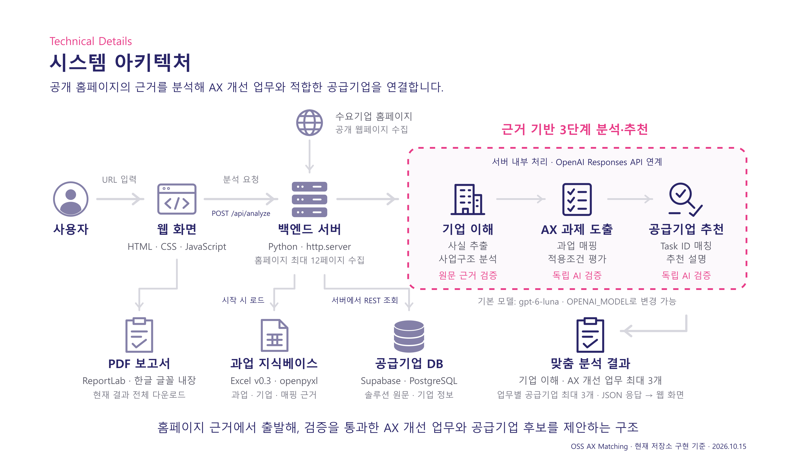

# OSS AX 매칭 시스템 아키텍처

2026-10-15 저장소 코드 기준. 첨부된 참고 이미지의 구성 방식을 따라 현재 구현을 정리했다. 실행 중인 서비스나 운영 DB의 현황을 조회한 문서는 아니다.

## 전체 흐름

사용자가 로그인 없이 수요기업 홈페이지 URL을 입력하면 Python 백엔드 서버가 공개 페이지를 최대 12개 수집한다. 수집한 원문으로 기업의 사업과 활동을 분석하고, Excel의 활성 AX 과업과 대조해 개선 업무를 도출한다. 이후 공통 Task ID로 공급기업 후보를 찾고 Supabase의 원본 프로필과 대조한다. 공급기업별 추천 설명과 업무 적합성 검증을 마친 결과를 웹 화면에 반환한다. 사용자는 현재 결과 전체를 PDF 보고서로 다운로드할 수 있다.

그림의 분홍 점선 영역은 서버가 순서대로 실행하는 논리적 처리 단계다. 각 단계에서 OpenAI Responses API를 호출하며, 공급기업 후보 조회와 점수 계산은 Python 코드가 수행한다. 기본 모델은 `gpt-6-luna`이고 `OPENAI_MODEL` 환경변수로 바꿀 수 있다. 그림의 3단계는 API 호출 횟수를 뜻하지 않는다.

## 구성 요소와 코드 근거

| 구성 요소 | 현재 구현 | 근거 |
| --- | --- | --- |
| 웹 화면 | HTML·CSS·JavaScript, URL 입력과 결과 표시 | `web/index.html`, `web/styles.css`, `web/app.js` |
| 백엔드 서버 | Python 3.11+, 현재 개발 실행은 `ThreadingHTTPServer`와 기본 주소 `127.0.0.1:8765`; 정적 화면·분석·PDF API 제공 | `src/oss/web_server.py`, `pyproject.toml` |
| 홈페이지 수집 | 분석 요청마다 최대 12페이지 수집; robots.txt, 같은 호스트, 페이지 수·응답 크기 제한 적용 | `src/oss/crawler.py`, `src/oss/web_server.py` |
| 기업 이해 | 원문 사실 추출 → 사업구조 재구성 → 설명 작성 → 별도 근거 검증 | `src/oss/business_profile.py` |
| AX 과제 도출 | 사업기능·사실을 활성 Task에 매핑 → 적용조건 평가 → 별도 검증; 화면에 최대 3개 제시 | `src/oss/ax_opportunity.py` |
| 공급기업 후보 매칭 | 공통 Task ID와 근거 수준을 이용한 점수 계산; 웹 경로에서는 스캔 후보 제외 | `src/oss/matching.py`, `src/oss/presentation.py` |
| 공급기업 프로필 대조 | Supabase REST API로 `suppliers`, `pool_entries` 조회; 원문 인용 또는 홈페이지 도메인으로 동일 기업 대조; 필수 프로필을 갖춘 후보 사용 | `src/oss/supplier_profile.py` |
| 공급기업 추천 설명 | 업무·기업 조합별 추천 이유, 활용 방법, 업무 변화, 상담 확인사항 작성 후 별도 AI 검증; 검증을 통과하지 못한 조합 제외 | `src/oss/supplier_advice.py` |
| 과업 지식베이스 | Excel v0.3을 openpyxl로 읽어 서버 메모리에 유지; Task·공급기업·솔루션·매핑 근거 사용 | `src/oss/workbook.py` |
| 공급기업 DB | Supabase/PostgreSQL의 공급기업·풀 원문·솔루션·수집 근거 저장 체계. 현재 웹 요청은 공급기업·풀 프로필을 직접 조회 | `supabase/migrations/20261009090856_supplier_knowledge_base.sql`, `src/oss/supplier_profile.py` |
| PDF 보고서 | 현재 화면의 전체 추천 결과를 전달받아 ReportLab과 내장 한글 글꼴로 메모리에서 PDF 생성·다운로드 | `web/app.js`, `src/oss/pdf_report.py`, `src/oss/web_server.py` |

## 요청 처리 순서

1. 웹 화면에서 `POST /api/analyze`로 URL을 보낸다.
2. 서버가 홈페이지를 수집하고 `analyze_business`를 실행한다.
3. `analyze_ax_opportunities`가 검증된 AX 개선 업무를 선정한다.
4. `available_profiles`가 Supabase의 공급기업 프로필을 조회하고 원본과 대조한다.
5. `build_front_result`가 업무별로 후보를 매칭하고, 프로필 조건을 갖춘 공급기업을 최대 3개씩 선정한다.
6. `add_supplier_advice`가 추천 설명을 작성·검증하며, 부적합한 업무·기업 조합을 제거한다. 최종 결과는 3개보다 적거나 없을 수 있다.
7. 서버가 JSON을 반환하고 브라우저가 현재 페이지에 결과를 표시한다. 자동 저장하지 않는다.
8. 사용자가 ‘보고서 다운로드’를 누르면 `POST /api/report.pdf`에 전체 업무·공급기업의 표시 데이터를 전달한다. 서버는 추가 분석 없이 PDF를 만들어 첨부파일로 반환한다. 결과와 PDF는 서버 파일이나 DB에 저장하지 않는다.

## 데이터 준비 경로

현재 웹 분석 요청과 별도로, AI바우처 공급기업 풀 스냅샷 → 데이터 정규화 → SQL 생성·적용으로 공급기업 DB를 준비한다. 공급기업 홈페이지 수집 결과도 별도 배치에서 페이지·청크로 적재할 수 있다. 세부 절차는 [공급기업 지식베이스](supplier-knowledge-base.md)와 [AX 과업 매핑](ax-matching.md)에 정리되어 있다.

현재 온라인 후보 매칭의 직접 기준은 서버 메모리의 Excel 지식베이스다. Supabase에 있는 과업 근거 테이블 전체를 실시간으로 검색하는 방식은 아니다. 로그인·개인 기록·계정별 결과 저장은 없으며, 현재 페이지를 새로고침하면 결과가 초기화된다. 기존 검색 기록 DB는 페이지 진입 시 정리한다. API 키는 서버 환경변수에서 읽는다.

## 산출물

- `system-architecture.png`: 공유·발표용 3600 × 2080 이미지.
- `system-architecture.svg`: 텍스트와 도형을 편집할 수 있는 벡터 원본.
- 본 문서: 구성 요소, 실행 흐름, 코드 근거 설명.
